# ReGrind

A fork of [Open Grind](https://git.opengrind.org/open-grind/open-grind), an unofficial, free and ad-free Grindr client.

This fork started because I wanted to try the app on my iPhone. The original builds for Android and desktop, so I got it running on iOS, then kept going and filled in the things I missed while using it every day.

I build this for myself and sideload it onto my own phone. If you want to try it, see [Install on iOS](#install-on-ios) or [Install on Android](#install-on-android).

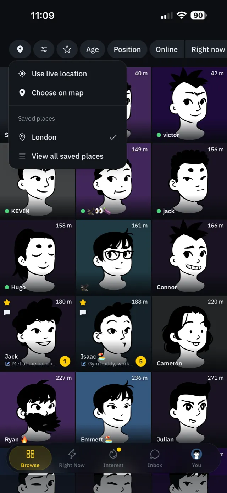
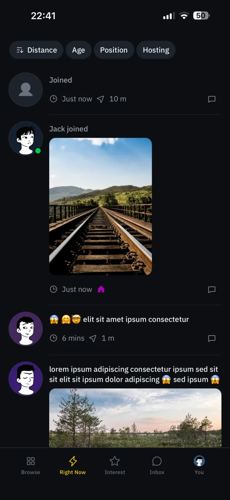
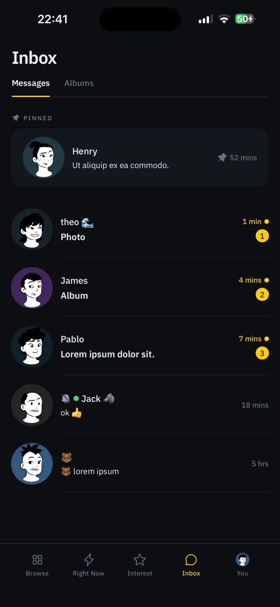

> Every screenshot here is from demo mode (`PUBLIC_ENABLE_DEMO=1`), so it's all mock data.

## Install on iOS

- **Install [SideStore](https://sidestore.io)** — follow its [setup guide](https://docs.sidestore.io/docs/installation/install).
- **Add this source** in SideStore, under Sources → **+**:

    ```
    https://git.opengrind.org/codexrunner/regrind/raw/branch/main/ci/altstore/source.json
    ```

- **Install ReGrind** from the source.

Needs iOS 15 or later. Apps installed this way stop working after 7 days — turn on LocalDevVPN, then open SideStore and hit refresh.

## Install on Android

- **Download the APK** from the [latest release](https://git.opengrind.org/codexrunner/regrind/releases/latest) — `regrind-v<version>-android.apk`.
- **Open it** on your phone and allow installing from your browser or file manager when Android asks.

Needs Android 9 or later. The package is `org.regrind`, so it installs alongside the original Open Grind rather than over it. It is signed with this fork's own key. The app checks this fork's releases for updates and can download and install them itself — Settings → App turns the automatic check off.

## What's different

Some of this is mine, some comes from pull requests that haven't landed in the original project yet.

### Interface

- General redesign with a minimalist look
- Redesigned settings
- Appearance of the app: pick your own theme, colors, etc
- Set your current location, or pick one on the map
- Save the places you teleport to and jump straight back to them
- Swipe between tabs
- Swipe between profiles
- Haptics feedback
- A small bubble that shows up when someone views your profile
- Tap 7 times on app version to enter / leave Demo mode

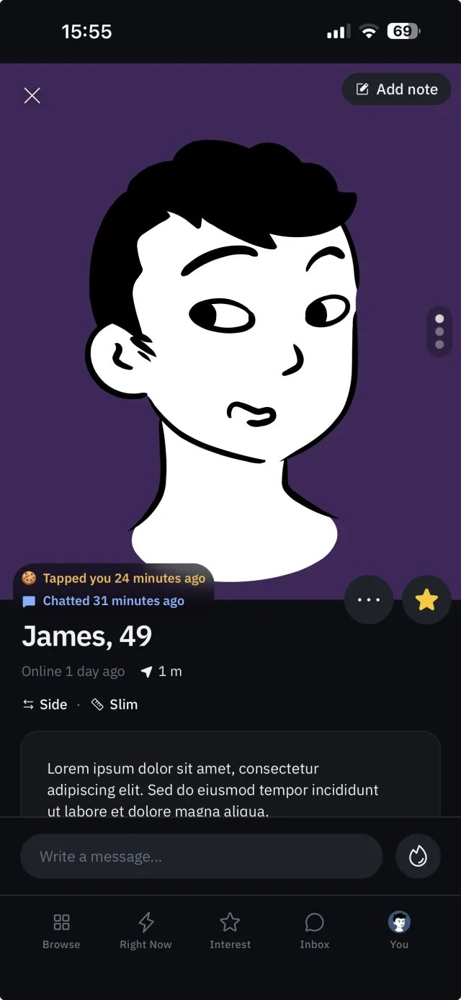
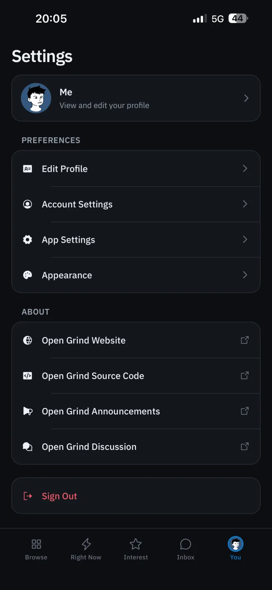
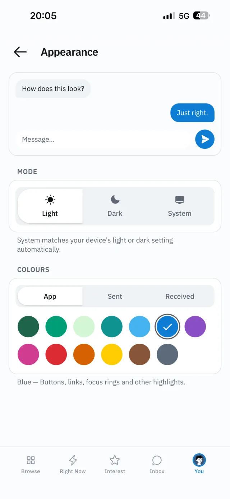

### Albums

- View albums shared with you
- Create and edit your own albums
- Add photos from your library to an album, or to your profile
- Share or unshare an album from the chat composer

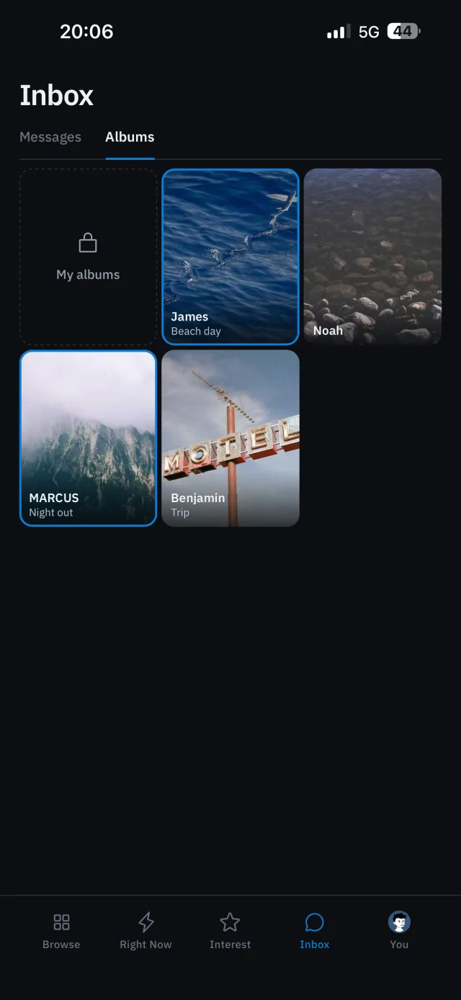
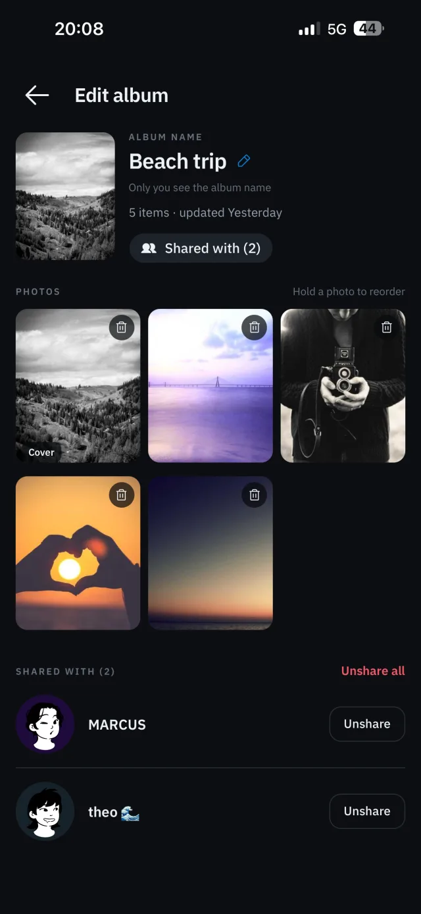
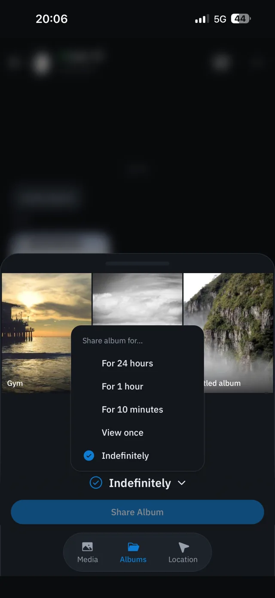

### Chat

- Voice messages: record and send them, play the ones you get
- Support for video messages and locations
- Support for video calls
- Reply to messages, photos, videos, locations
- Share your location or pick a location
- Download media (photos / videos), or hold the download button to save a whole set at once
- Received photos gallery. All the photos from a conversation in one place, reachable from the chat top bar.

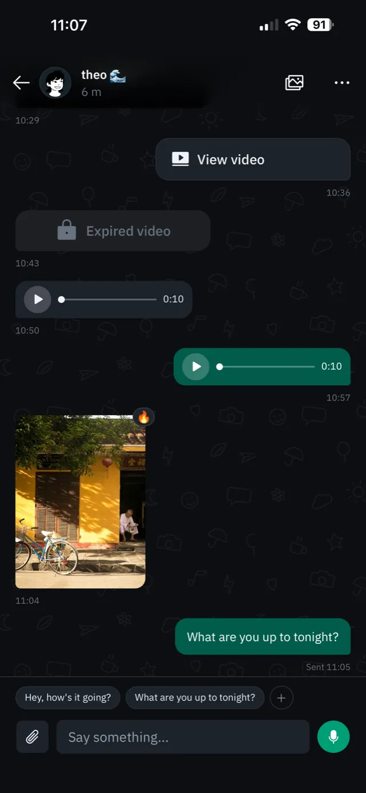
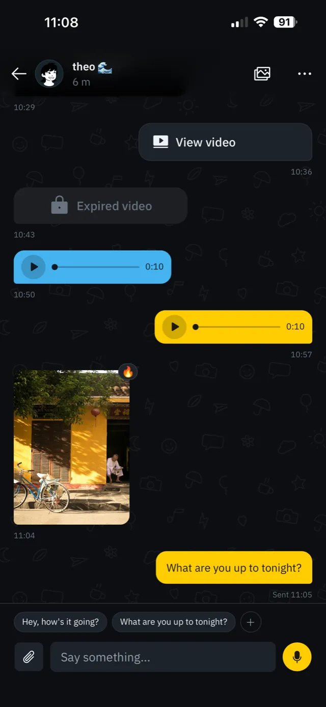
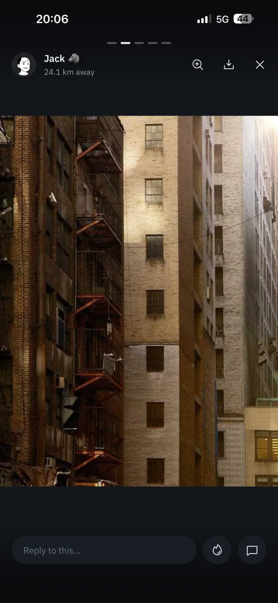

### Accounts

- Sign several accounts in and switch between them from the account card at the top of Settings
- Each account keeps its own device identity, session, location, filters and online setting
- Only the account you're using is online. The others hold their sign-in but stay disconnected, so nobody sees them online until you switch back — which also means only the account in use notifies you.

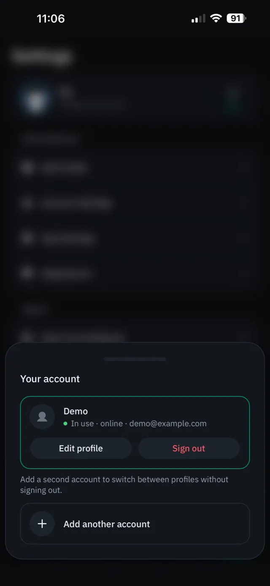
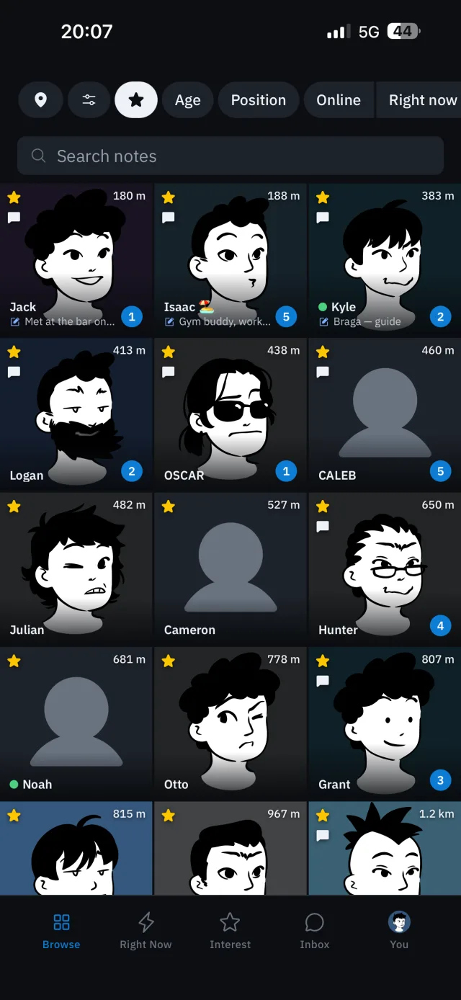

## Building

Same as the original project, see [BUILDING.md](./BUILDING.md) and [CONTRIBUTING.md](./CONTRIBUTING.md). For iOS you'll also need Xcode and your own signing identity.

## Credit

All the real work belongs to the [original project](https://git.opengrind.org/open-grind/open-grind). Thanks to everyone who builds and maintains it.

## License

[MIT](./LICENSE), same as the original project.
